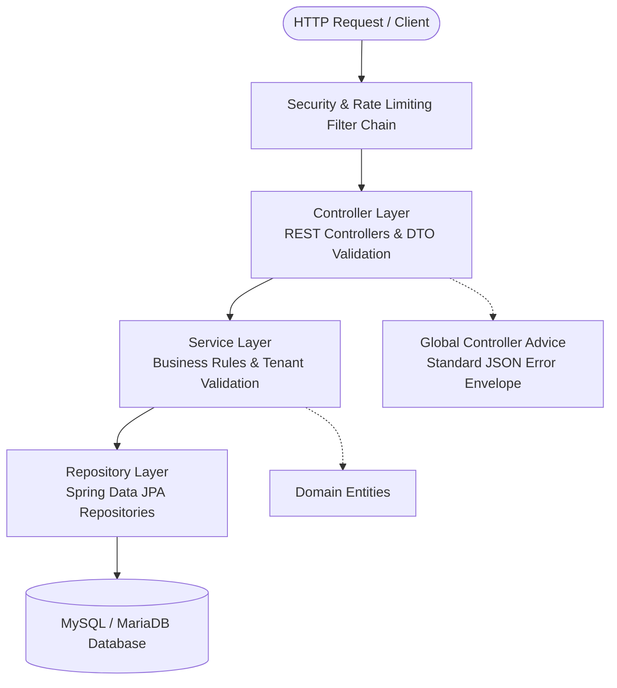

# Backend Architecture & REST API Routes Specification

**Project**: Multi-Restaurant QR Code In-Dining & Reservation Platform  
**Target Audience**: Academic Mentors, Backend Engineers, API Consumers, Technical Evaluators  
**Core Technologies**: Java 21, Spring Boot 3.x, Spring Data JPA, Hibernate 6, MySQL / MariaDB, JJWT, Jakarta Validation  

---

## 1. Architectural Philosophy & Layered Structure

The backend follows the canonical **Spring Boot Layered Architecture** with strict separation of concerns, clean DTO mappings, and zero direct entity exposure across HTTP boundaries.



### 1.1 Package Topology (`com.qr_restaurant.qr_restaurant_backend`)
- **`config/`**: Security configuration, CORS settings, database pooling, and initial seed data runner (`DataInitializer`).
- **`controller/`**: REST endpoints grouped cleanly by actor persona (`AuthController`, `CustomerController`, `KitchenController`, `WaiterController`, `ManagerController`, `HealthCheckController`).
- **`dto/`**: Strongly-typed request/response Data Transfer Objects annotated with Jakarta validation (`@NotBlank`, `@NotNull`, `@Min`).
- **`exception/`**: Domain exceptions (`ResourceNotFoundException`, `BadRequestException`, `UnauthorizedException`) handled centrally via `@RestControllerAdvice`.
- **`model/`**: JPA Entities mapping directly to database tables, including lifecycle hooks (`@PrePersist`, `@PreUpdate`).
- **`repository/`**: Spring Data JPA interfaces extending `JpaRepository` with custom JPQL queries enforcing multi-tenant constraints.
- **`security/`**: JWT validation filter (`JwtAuthenticationFilter`), BCrypt password hashing, rate limiting, and HTTP security headers.
- **`service/`**: Core transaction-managed business logic (`@Transactional`) and multi-tenant authorization guards.

---

## 2. Exhaustive REST API Route Catalog

All routes are prefixed with `/api`. Below is the complete contract consumed by the frontend and external services:

### 2.1 Authentication & Restaurant Onboarding (`/api/auth/**`)

| Method | Endpoint Path | Access / Role | Request Payload / Params | Response Schema | Description |
| :--- | :--- | :--- | :--- | :--- | :--- |
| `POST` | `/api/auth/login` | Public | `LoginRequest` `{ username, password }` | `AuthResponse` `{ token, username, role, restaurantId, restaurantName, fullName }` | Authenticates staff member using BCrypt, generates signed JWT with role and restaurant claims. |
| `POST` | `/api/auth/register-restaurant` | Public | `RegisterRestaurantRequest` `{ restaurantName, slug, address, phone, adminUsername, adminPassword, adminFullName }` | `AuthResponse` `{ token, username, role, restaurantId, restaurantName }` | Registers a new restaurant tenant, initializes default categories and admin user, returns JWT. |
| `GET` | `/api/auth/restaurants` | Public | *None* | `List<RestaurantResponse>` `[{ id, name, slug, address, phone, logoUrl }]` | Returns directory of active registered restaurants for portal discovery. |

---

### 2.2 Customer Dining & Self-Ordering (`/api/customer/**`)
*Authentication: Guest Table Context (`sessionToken` / `tableNumber` / `qrToken`). No login required.*

| Method | Endpoint Path | Access / Role | Request Payload / Params | Response Schema | Description |
| :--- | :--- | :--- | :--- | :--- | :--- |
| `POST` | `/api/customer/session/start` | Public Guest | `StartSessionRequest` `{ tableNumber, qrToken, sessionToken, restaurantId, restaurantSlug }` | `SessionResponse` `{ sessionToken, tableNumber, restaurantId, restaurantName, status, startTime }` | Starts a new dining table session or validates/reconnects an existing session token for co-diners. |
| `GET` | `/api/customer/categories` | Public Guest | Query: `restaurantId`, `restaurantSlug` | `List<CategoryResponse>` `[{ id, name, displayOrder }]` | Retrieves active menu categories for the target restaurant. |
| `GET` | `/api/customer/menu` | Public Guest | Query: `categoryId`, `search`, `restaurantId`, `restaurantSlug` | `List<DishResponse>` `[{ id, name, description, price, imageUrl, isVeg, isAvailable, preparationTimeMinutes, optionsJson }]` | Retrieves menu dishes filtered by category, search term, and availability. |
| `POST` | `/api/customer/orders` | Table Session | `CreateOrderRequest` `{ sessionToken, items: [{ dishId, quantity, specialInstructions }], notes }` | `OrderResponse` `{ id, orderNumber, tableNumber, status, totalAmount, taxAmount, items, createdAt }` | Submits an order. Computes 5% tax, executes 5-second duplicate protection, and sends to kitchen. |
| `GET` | `/api/customer/orders/session/{sessionToken}` | Table Session | Path: `sessionToken` | `List<OrderResponse>` | Retrieves all historical and active orders placed during this dining table session. |
| `POST` | `/api/customer/assistance` | Table Session | `AssistanceRequestDto` `{ sessionToken, requestType, note }` | `AssistanceResponse` `{ id, tableNumber, requestType, status, createdAt }` | Dispatches waiter call (`WATER`, `CLEAN_TABLE`, `CALL_WAITER`, `BILL_REQUEST`). |
| `GET` | `/api/customer/bill/receipt/{sessionToken}` | Table Session | Path: `sessionToken` | `BillReceiptResponse` `{ sessionToken, tableNumber, restaurantName, items, subtotal, tax, grandTotal, ordersCount }` | Generates consolidated digital bill breakdown for in-session orders. |
| `POST` | `/api/customer/bill/pay` | Table Session | `PaymentRequest` `{ sessionToken, paymentMethod, amountPaid }` | `PaymentResponse` `{ receiptId, status, timestamp, message }` | Records digital payment settlement (UPI, Card, Cash) and flags table as paid. |
| `DELETE` | `/api/customer/orders/{orderId}` | Table Session | Path: `orderId`, Query: `sessionToken` | `SuccessResponse` `{ message }` | Cancels an order before preparation begins (`PLACED` status only). |

---

### 2.3 Kitchen Display System (`/api/kitchen/**`)
*Authentication: Staff JWT with Role `KITCHEN` or `ADMIN`.*

| Method | Endpoint Path | Access / Role | Request Payload / Params | Response Schema | Description |
| :--- | :--- | :--- | :--- | :--- | :--- |
| `GET` | `/api/kitchen/orders` | `KITCHEN`, `ADMIN` | *None* (Tenant extracted from JWT) | `List<KitchenOrderResponse>` `[{ id, orderNumber, tableNumber, status, items, notes, createdAt }]` | Fetches active kitchen pipeline orders (`PLACED`, `PREPARING`) strictly for the staff's restaurant. |
| `PATCH` | `/api/kitchen/orders/{orderId}/status` | `KITCHEN`, `ADMIN` | Path: `orderId`, Query: `status` (`PREPARING`, `READY`) | `OrderResponse` | Transitions order cooking status along the preparation lifecycle. |

---

### 2.4 Waiter Floor Operations (`/api/waiter/**`)
*Authentication: Staff JWT with Role `WAITER` or `ADMIN`.*

| Method | Endpoint Path | Access / Role | Request Payload / Params | Response Schema | Description |
| :--- | :--- | :--- | :--- | :--- | :--- |
| `GET` | `/api/waiter/tables` | `WAITER`, `ADMIN` | *None* (Tenant extracted from JWT) | `List<TableStatusResponse>` `[{ id, tableNumber, capacity, status, activeSessionToken }]` | Returns live floor map with occupancy status for all tables in staff's restaurant. |
| `PATCH` | `/api/waiter/tables/{tableId}/status` | `WAITER`, `ADMIN` | Path: `tableId`, Query: `status` (`AVAILABLE`, `OCCUPIED`, `DIRTY`, `RESERVED`) | `TableResponse` | Manually updates table floor status (e.g., marks table cleaned). |
| `GET` | `/api/waiter/assistance` | `WAITER`, `ADMIN` | *None* (Tenant extracted from JWT) | `List<AssistanceResponse>` | Retrieves pending waiter assistance requests for the restaurant floor. |
| `PATCH` | `/api/waiter/assistance/{requestId}/resolve` | `WAITER`, `ADMIN` | Path: `requestId` | `AssistanceResponse` | Marks guest assistance call as resolved. |
| `GET` | `/api/waiter/orders/ready` | `WAITER`, `ADMIN` | *None* (Tenant extracted from JWT) | `List<OrderResponse>` | Fetches all orders currently marked `READY` waiting for pickup to be delivered to guests. |
| `PATCH` | `/api/waiter/orders/{orderId}/serve` | `WAITER`, `ADMIN` | Path: `orderId` | `OrderResponse` | Marks an order as `SERVED` upon delivery to the physical dining table. |
| `POST` | `/api/waiter/tables/{tableId}/checkout` | `WAITER`, `ADMIN` | Path: `tableId` | `SuccessResponse` `{ message }` | Closes active table session, marks table `AVAILABLE`, and liberates table for next diners. |

---

### 2.5 Manager Administration & Analytics (`/api/manager/**`)
*Authentication: Staff JWT with Role `ADMIN` only.*

| Method | Endpoint Path | Access / Role | Request Payload / Params | Response Schema | Description |
| :--- | :--- | :--- | :--- | :--- | :--- |
| `GET` | `/api/manager/analytics/dashboard` | `ADMIN` | *None* (Tenant extracted from JWT) | `DashboardStatsResponse` `{ totalRevenue, totalOrders, activeTablesCount, popularDishes }` | Calculates live business metrics strictly within authenticated manager's restaurant. |
| `GET` | `/api/manager/categories` | `ADMIN` | *None* | `List<CategoryResponse>` | Returns all categories belonging to the restaurant. |
| `POST` | `/api/manager/categories` | `ADMIN` | `CategoryRequest` `{ name, displayOrder }` | `CategoryResponse` | Creates a new menu category. |
| `PUT` | `/api/manager/categories/{id}` | `ADMIN` | Path: `id`, Body: `CategoryRequest` | `CategoryResponse` | Updates existing menu category (verifies restaurant ownership). |
| `DELETE`| `/api/manager/categories/{id}` | `ADMIN` | Path: `id` | `SuccessResponse` | Deletes a category and associated non-cascaded linkages. |
| `GET` | `/api/manager/dishes` | `ADMIN` | *None* | `List<DishResponse>` | Retrieves all dishes configured for the restaurant. |
| `POST` | `/api/manager/dishes` | `ADMIN` | `DishRequest` `{ name, description, price, categoryId, imageUrl, isVeg, preparationTimeMinutes, optionsJson }` | `DishResponse` | Adds a new dish to the restaurant catalog. |
| `PUT` | `/api/manager/dishes/{id}` | `ADMIN` | Path: `id`, Body: `DishRequest` | `DishResponse` | Modifies dish details, pricing, and ingredients. |
| `PATCH` | `/api/manager/dishes/{id}/toggle-availability`| `ADMIN` | Path: `id` | `DishResponse` | Instantly toggles dish between Available and 86'd (out-of-stock). |
| `DELETE`| `/api/manager/dishes/{id}` | `ADMIN` | Path: `id` | `SuccessResponse` | Removes dish from restaurant catalog. |
| `GET` | `/api/manager/tables` | `ADMIN` | *None* | `List<TableResponse>` | Retrieves all registered physical tables and QR tokens. |
| `POST` | `/api/manager/tables` | `ADMIN` | `TableRequest` `{ tableNumber, capacity }` | `TableResponse` | Registers a new physical table with auto-generated secure QR token. |
| `POST` | `/api/manager/tables/{id}/regenerate-qr` | `ADMIN` | Path: `id` | `TableResponse` | Regenerates a fresh cryptographic QR token, invalidating old printed codes. |
| `GET` | `/api/manager/orders` | `ADMIN` | *None* | `List<OrderResponse>` | Historical audit log of all restaurant orders and billing totals. |

---

### 2.6 System Health & Observability (`/api/health` & Spring Actuator)

| Method | Endpoint Path | Access / Role | Response Schema | Description |
| :--- | :--- | :--- | :--- | :--- |
| `GET` | `/api/health` | Public | `HealthResponse` `{ status: "UP", database: "CONNECTED", activeConnections, timestamp }` | Custom application health check verifying database connectivity and connection pool metrics. |
| `GET` | `/actuator/health` | Public | Standard Spring Boot Actuator Health `{ status: "UP", components: { db: { status: "UP" } } }` | Production container/liveness probe target for cloud platforms. |

---

## 3. Core Business Logic & Guardrails

### 3.1 5-Second Duplicate Order Protection
To protect diners from accidental rapid tapping on slow mobile networks, `CustomerService` enforces an in-memory sliding debounce window keyed by `sessionToken`:
- When an order request arrives, the hash of `items + sessionToken` is checked against recent submissions.
- If an identical order arrives within 5,000 milliseconds, the duplicate request is rejected with `HTTP 409 Conflict` ("Duplicate order detected. Please wait a moment before submitting again.").

### 3.2 Dynamic Pricing & Tax Calculation
Prices are never trusted from the client request payload:
- The backend queries the canonical unit price of each item directly from the `dishes` table.
- Subtotal is computed as $\sum (\text{unitPrice} \times \text{quantity})$.
- A mandatory 5% Goods and Services Tax (GST) is calculated: $\text{taxAmount} = \text{subtotal} \times 0.05$.
- Total amount is persisted with financial accuracy using `java.math.BigDecimal` (scale 2).

### 3.3 Strict Order Status Progression
The kitchen and waiter state machine transitions linearly:
$$\text{PLACED} \longrightarrow \text{PREPARING} \longrightarrow \text{READY} \longrightarrow \text{SERVED}$$
- Diners may only cancel orders in `PLACED` state.
- Once a chef marks an order `PREPARING`, cancellations are blocked to prevent food waste.

---

## 4. Exception Handling & Uniform Response Envelope

All uncaught exceptions and validation failures are intercepted by `@RestControllerAdvice`:

```json
{
  "timestamp": "2026-10-16T22:30:00.000Z",
  "status": 404,
  "error": "Not Found",
  "message": "Dish with id 42 does not exist for this restaurant.",
  "path": "/api/manager/dishes/42"
}
```

---

## 5. Mentor Presentation Slide Highlights (PPT Cheat Sheet)

- **Slide 1: Spring Boot 3 & Java 21 Foundation**
  - "Built on modern Java 21 leveraging Virtual Threads and Spring Boot 3 for high-throughput, low-latency REST APIs."
- **Slide 2: Robust Zero-Trust Parameter Validation**
  - "Client prices and tenant IDs are never trusted. All calculations and tenant scopes are verified server-side."
- **Slide 3: High-Performance Connection Pooling**
  - "Configured with HikariCP (20 connections) and Hibernate batch fetching (`batch_size=50`) to eliminate N+1 query bottlenecks."
- **Slide 4: Self-Healing & Observable**
  - "Integrated Spring Boot Actuator and custom `/api/health` probes for real-time connection and uptime monitoring."
