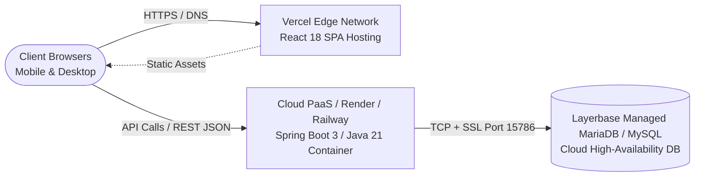

# Production Deployment, Mentor Handover & Presentation Guide

**Project**: Multi-Restaurant QR Code In-Dining & Reservation Platform  
**Target Audience**: Academic Mentors, System Evaluators, DevOps Engineers, and Presenters  
**Purpose**: Complete turnkey guide for deploying to production, conducting a live demonstration, and structuring the evaluation PPT.

---

## 1. Production Architecture & Cloud Topology

The platform is designed as a decoupled, cloud-native architecture separating static edge delivery from high-performance transactional services:



### 1.1 Infrastructure Components
| Layer | Hosting Platform | Tech Stack | Responsibilities |
| :--- | :--- | :--- | :--- |
| **Frontend Web** | **Vercel** / **Netlify** | React 18, Vite | Global CDN caching, instant SSL certificate, client-side route rewrites via `vercel.json`. |
| **Backend API** | **Render** / **Railway** / **AWS EC2** | Java 21, Spring Boot 3 | Stateless REST API, JWT authentication, rate limiting, connection pooling. |
| **Cloud Database** | **Layerbase Cloud** / **AWS RDS** | MariaDB 10.x / MySQL 8.0 | High-availability relational database, transactional ACID compliance, automated snapshots. |

---

## 2. Step-by-Step Deployment Instructions

### 2.1 Frontend Deployment (Vercel)
1. **Routing Rewrite Configuration (`vercel.json`)**:
   Verify that `vercel.json` exists in the repository root to ensure React Router paths (like `/kitchen`, `/table/1`) do not return 404 on page refresh:
   ```json
   {
     "rewrites": [
       { "source": "/(.*)", "destination": "/index.html" }
     ]
   }
   ```
2. **Environment Variable Configuration**:
   In your Vercel Project Dashboard $\rightarrow$ **Settings** $\rightarrow$ **Environment Variables**, configure:
   - `VITE_API_BASE_URL`: `https://your-backend-service.onrender.com/api`
3. **Build Settings**:
   - **Framework Preset**: Vite
   - **Root Directory**: `frontend`
   - **Build Command**: `npm run build`
   - **Output Directory**: `dist`

---

### 2.2 Backend Deployment (Render / Railway / VPS)
1. **Compilation & Packaging**:
   Produce a standalone executable Spring Boot JAR:
   ```bash
   cd backend
   ./mvnw clean package -DskipTests
   ```
   The executable JAR is generated at `backend/target/qr-restaurant-backend-0.0.1-SNAPSHOT.jar`.

2. **Environment Variables on Cloud Host**:
   Configure the following secure environment variables:
   ```bash
   SPRING_DATASOURCE_URL=jdbc:mysql://cloud.layerbase.dev:15786/qr_restaurant_db?useSSL=true&verifyServerCertificate=false&allowPublicKeyRetrieval=true
   DB_USERNAME=root
   DB_PASSWORD=YOUR_STRONG_DB_PASSWORD
   JWT_SECRET=QR_RESTAURANT_SUPER_SECURE_JWT_SECRET_KEY_2026_MIN_256_BITS_LONG!
   JWT_EXPIRATION_MS=86400000
   PORT=8080
   ```

3. **Running the Application**:
   ```bash
   java -jar -Dserver.port=$PORT target/qr-restaurant-backend-0.0.1-SNAPSHOT.jar
   ```

---

## 3. Pre-Flight Handover Checklist

Before handing the URL to mentors or beginning your evaluation demo, verify these 6 items:

- [ ] **1. Cloud Database Connectivity**: Visit `/api/health` in your browser. Confirm `status: "UP"` and `database: "CONNECTED"`.
- [ ] **2. Seed Data Verification**: Ensure default accounts are present:
  - Admin: `admin` / `admin123`
  - Chef: `chef` / `chef123`
  - Waiter: `waiter` / `waiter123`
- [ ] **3. CORS Allowed Origins**: Verify that the deployed Vercel domain (e.g., `https://restaurant-qr-ordering.vercel.app`) is matched by `cors.allowed-origins` in `application.properties`.
- [ ] **4. Camera QR Permissions**: Ensure test phone camera or browser permissions allow camera access for the scanner modal.
- [ ] **5. Test Order Execution**: Place a ₹0/test order on Table 1; confirm it pops on `/kitchen` and Waiter can mark it `SERVED`.
- [ ] **6. No Secrets in Public Git**: Verify `.env` files and local passwords are listed in `.gitignore`.

---

## 4. 5-Minute Live Mentor Demonstration Script

Follow this choreographed script during your presentation to showcase the full end-to-end synchronized lifecycle:

### Step 1: The Diner Experience (Mobile Screen or 1st Browser Window)
- **Action**: Open `/r/spice-garden/table/1` (simulate scanning Table 1 QR).
- **Mentor Commentary**: *"Here is what a diner sees immediately after sitting down at Table 1. Notice there was zero requirement to download an app or create an account. The system automatically negotiated a cryptographic Table Session."*
- **Action**: Toggle the **Pure Veg** switch, search for "Paneer", click the dish, choose "Spicy", and click **Add to Cart**.
- **Action**: Open cart, review the calculated 5% tax, and click **Place Order**.
- **Mentor Commentary**: *"Notice the 5-second debounce protection preventing duplicate charges, and the instant order confirmation ticket."*

### Step 2: The Kitchen Display System (2nd Browser Window / `/kitchen`)
- **Action**: Switch to the `/kitchen` window (logged in as `chef`).
- **Mentor Commentary**: *"Without refreshing, the chef sees Table 1's order appear with the timer ticking. The chef clicks 'Start Preparing', transitioning the order to preparing state."*
- **Action**: Click **Mark Ready**.
- **Mentor Commentary**: *"The kitchen pipeline has now flagged this order as ready for pickup on the restaurant floor."*

### Step 3: The Waiter Floor Operations (3rd Browser Window / `/waiter`)
- **Action**: Switch to `/waiter` (logged in as `waiter`).
- **Mentor Commentary**: *"The floor waitstaff sees Table 1 highlighted. In the 'Ready for Pickup' queue, Table 1's dish is waiting. The waiter picks it up, delivers it to the table, and clicks 'Mark Served'."*
- **Action**: Return to Customer Portal to demonstrate the live order card now showing `SERVED`.
- **Action**: On customer portal, click **Call Waiter** $\rightarrow$ **Request Water**.
- **Action**: Switch to Waiter Portal to show the instant pulsing alert, and click **Resolve**.

### Step 4: Digital Billing & Manager Analytics (`/manager`)
- **Action**: On customer portal, click **View Receipt & Pay**, select UPI/Cash, and complete payment.
- **Action**: Switch to `/manager` (logged in as `admin`).
- **Mentor Commentary**: *"The manager dashboard updates in real time. We see today's revenue, order counts, active occupancy, and can instantly 86 out-of-stock dishes or download freshly regenerated table QR codes."*

---

## 5. Complete PPT Presentation Slide Deck Structure

Use this 12-slide blueprint to create your PowerPoint / Google Slides deck:

### Slide 1: Title & Project Overview
- **Title**: Unified Multi-Restaurant QR In-Dining & Management Ecosystem
- **Subtitle**: Zero-App Self-Ordering, Real-Time Kitchen Display System & Multi-Tenant Floor Operations
- **Presenter Details**: Your Name, Roll Number, Mentors / Guide Name, Academic Year.
- **Visual**: High-res mockup of mobile customer portal + desktop manager dashboard.

### Slide 2: Problem Statement & Industry Friction
- **Bullet Points**:
  - Diners hate waiting 15+ minutes for menus and bill requests during peak hours.
  - Traditional POS hardware is expensive, proprietary, and isolated from diners.
  - Third-party delivery aggregators charge exorbitant commissions (20-30%) for dine-in.
  - Miscommunication between floor staff and kitchen leads to order errors and food waste.

### Slide 3: The Solution: Tri-Party Synchronized Ecosystem
- **Bullet Points**:
  - **Diners**: Instant QR self-ordering, dietary filters, group session sharing, digital billing.
  - **Kitchen**: Touch-friendly KDS pipeline (`PLACED` $\rightarrow$ `PREPARING` $\rightarrow$ `READY`).
  - **Waiters**: Real-time floor status map, guest assistance dispatch, ready order delivery.
  - **Managers**: Centralized multi-tenant menu control, dynamic stock toggles, and revenue analytics.

### Slide 4: System Architecture & Tech Stack
- **Visual**: Mermaid Architecture Diagram (Frontend $\leftrightarrow$ Backend $\leftrightarrow$ Database).
- **Bullet Points**:
  - **Frontend**: React 18 SPA, Vite, Lucide Icons, Vanilla CSS Glassmorphism.
  - **Backend**: Java 21, Spring Boot 3 REST API, Spring Data JPA, Hibernate 6.
  - **Database**: Cloud MariaDB/MySQL with HikariCP connection pooling.
  - **Security**: JWT authentication, BCrypt hashing, Token-Bucket Rate Limiter.

### Slide 5: Frontend Design & Glassmorphism UX
- **Bullet Points**:
  - Custom design tokens with ambient dark mode optimized for low-light restaurants.
  - Accessible dietary badges combining distinct colors, border geometry, and typography.
  - Minimum 44×44px touch targets designed for fast one-handed mobile ordering.
  - Zero-lag optimistic rendering with proactive 401/403 event dispatchers.

### Slide 6: Backend Engineering & Performance Optimization
- **Bullet Points**:
  - Canonical layered architecture (`Controller` $\rightarrow$ `Service` $\rightarrow$ `Repository` $\rightarrow$ `Entity`).
  - Elimination of N+1 Hibernate overhead via `batch_size=50` and `default_batch_fetch_size=100`.
  - In-memory 5-second duplicate order protection window to eliminate double billing.
  - Financial calculations enforced server-side using `java.math.BigDecimal`.

### Slide 7: Strict Multi-Tenant Security & Anti-IDOR
- **Bullet Points**:
  - Strict zero-trust tenant isolation: client-supplied restaurant IDs are completely ignored for staff actions.
  - Staff restaurant identity derived exclusively from cryptographically signed JWT claims.
  - Defense-in-depth: IP Rate Limiting + Security Headers (HSTS, CSP, X-Frame-Options: DENY) + CORS.
  - Passwords hashed with BCrypt (cost factor 12) with salted digests and zero plaintext fallback.

### Slide 8: Database Design & Entity Relationships
- **Visual**: Entity Relationship Diagram (ERD).
- **Bullet Points**:
  - 9 normalized relational tables maintaining strict tenant foreign keys.
  - Composite unique constraints: `(restaurant_id, table_number)` and `(restaurant_id, name)`.
  - Immutable price and item snapshots in `order_items` ensuring historical billing integrity.
  - Indexed queries for sub-millisecond status polling (`restaurant_id`, `status`).

### Slide 9: Complete In-Dining Lifecycle Walkthrough
- **Visual**: Sequential flowchart from QR Scan $\rightarrow$ Order $\rightarrow$ Kitchen KDS $\rightarrow$ Waiter Serve $\rightarrow$ Receipt.
- **Bullet Points**:
  - Real-time waiter calls (Water, Cleaning, Waiter, Bill).
  - Synchronized table session tokens allowing co-diners to order together.
  - Order status progression state machine preventing post-prep cancellations.

### Slide 10: Live Demonstration Overview
- *Placeholder for switching to browser to run the 5-minute live demo script.*

### Slide 11: Future Enhancements & Extensibility
- **Bullet Points**:
  - WebSocket / SSE push notifications replacing short polling intervals.
  - Automated Table Pre-Booking & Reservation Calendar module.
  - Direct UPI Deep-Linking & Payment Gateway webhooks (Razorpay / Stripe).
  - Kitchen ticket printer integration via Web Serial / Bluetooth ESC/POS.

### Slide 12: Conclusion & Q&A
- **Summary**: Delivered a production-ready, secure, zero-friction in-dining ordering platform.
- **Code Repository & Live Demo URL**: *Include your Vercel URL and GitHub repository link*.
- **Closing**: "Thank you! We welcome questions and feedback from our mentors."
