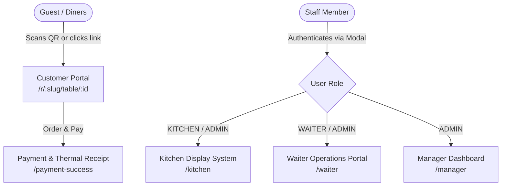
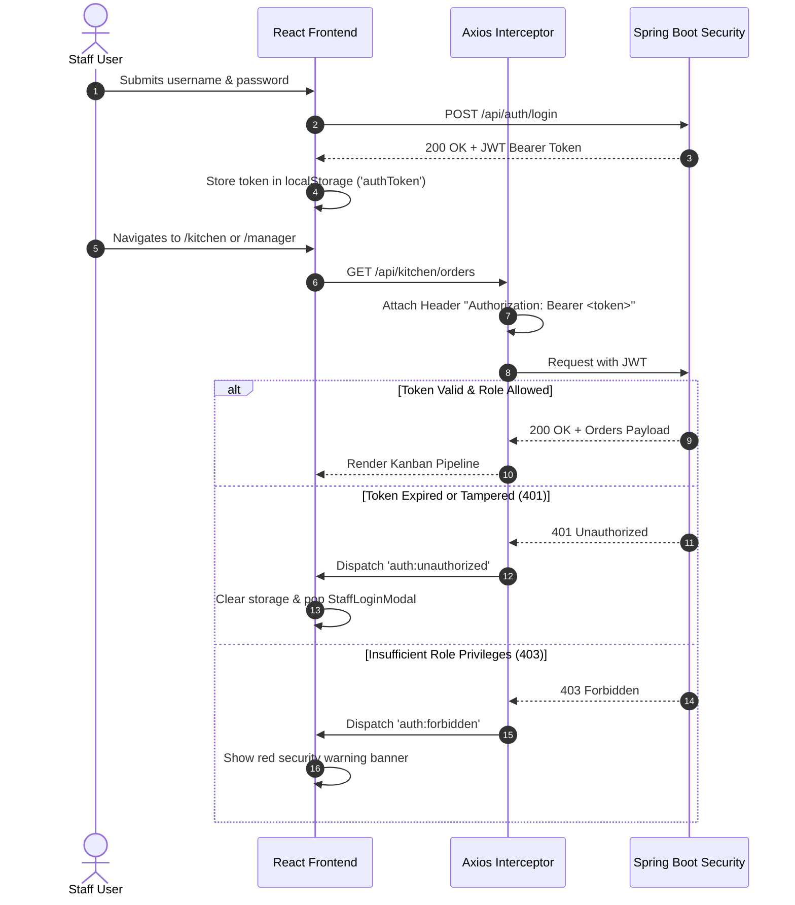

# Frontend Design & Routes Specification

**Project**: Multi-Restaurant QR Code In-Dining & Reservation Platform  
**Target Audience**: Academic Mentors, System Architects, Technical Evaluators, and Frontend Developers  
**Core Technologies**: React 18, Vite, React Router DOM v6, Axios, Lucide React, Modern CSS3 Glassmorphism  

---

## 1. Executive Summary & Architectural Overview

The frontend is a ultra-responsive Single Page Application (SPA) built with **React 18** and bundled with **Vite**. It delivers an app-like mobile and desktop experience without requiring diners or staff to install any native mobile app.



### Key Technical Characteristics
1. **Zero-App-Store Friction**: Diners scan standard camera QR codes directly opening web browsers with instant table binding.
2. **Dual-Tier State Isolation**:
   - **Customer Guest State**: Driven by `TableSession` tokens (`SESS-XXXXXX`) stored in `localStorage` with zero login requirements.
   - **Staff Operational State**: Governed by cryptographic JWTs stored in `localStorage`, attached automatically by Axios interceptors.
3. **Decoupled API Client**: Centralized HTTP client (`services/api.js`) featuring proactive event dispatchers for `401 Unauthorized` and `403 Forbidden` responses.
4. **Optimistic Rendering & Resilient Polling**: Dynamic fallback states and micro-animations ensure buttery 60 FPS interactions even on congested restaurant Wi-Fi.

---

## 2. Visual Design System & Aesthetics

The application implements a custom **Glassmorphism Design System** designed for high contrast in low-light dining atmospheres, kitchen visibility from 3+ meters away, and rapid one-handed mobile interactions.

### 2.1 Design Tokens (`index.css`)
| Token Category | CSS Custom Property | Default Dark Theme Value | Purpose |
| :--- | :--- | :--- | :--- |
| **Primary Accent** | `--primary` | `#6366f1` (Electric Indigo) | Primary call-to-actions, brand identity |
| **Accent Glow** | `--accent` | `#f43f5e` (Vibrant Rose) | Order counters, destructive actions, high-priority alerts |
| **Background Dark** | `--bg-primary` | `#0f172a` (Deep Slate / Obsidian) | Immersive root background |
| **Surface Elev. 1** | `--bg-glass` | `rgba(30, 41, 59, 0.70)` | Glass cards, floating modals, navigation bars |
| **Surface Elev. 2** | `--bg-glass-card` | `rgba(255, 255, 255, 0.04)` | Nested dish cards, table tiles, inputs |
| **Border Highlights**| `--border-glass` | `rgba(255, 255, 255, 0.10)` | Translucent borders capturing incident light |
| **Text Primary** | `--text-primary` | `#f8fafc` | Headers, prices, primary labels |
| **Text Muted** | `--text-secondary` | `#94a3b8` | Subtitles, ingredients, category descriptions |
| **Success / Veg** | `--color-veg` | `#22c55e` (Emerald Green) | Pure veg badge, ready status, paid bills |
| **Warning / Alert** | `--color-warning` | `#f59e0b` (Amber) | Table assistance requested, pending orders |
| **Non-Veg / Danger**| `--color-non-veg` | `#ef4444` (Crimson) | Non-veg badge, occupied tables, cancellations |

### 2.2 Glassmorphism Recipe
All card and modal surfaces adhere to the following specification:
```css
background: rgba(30, 41, 59, 0.65);
backdrop-filter: blur(12px) saturate(180%);
-webkit-backdrop-filter: blur(12px) saturate(180%);
border: 1px solid rgba(255, 255, 255, 0.08);
box-shadow: 0 8px 32px 0 rgba(0, 0, 0, 0.37);
```

### 2.3 Ergonomics & Accessibility
- **Minimum Touch Target**: 44×44px across all clickable elements for easy single-handed thumb operation.
- **Dietary Distinguishability**: Pure Veg vs. Non-Veg indicators combine color, border shape, and clear typography (never relying on color alone).
- **Audio & Visual Alerts**: Kitchen orders and waiter assistance triggers produce pulsing glow animations (`pulse-ring`) visible across noisy physical floors.

---

## 3. Frontend Routes Catalog

The application routing is configured in [`frontend/src/App.jsx`](file:///d:/DevSpace/Restaurant-QR-Ordering-System/frontend/src/App.jsx) via React Router DOM v6:

| Route Path | Component | Target Role / Persona | Authentication Required | Description & Key Functionality |
| :--- | :--- | :--- | :--- | :--- |
| `/` | `LandingPage.jsx` | Public / Explorers / Staff | None (Public) | Hero presentation, live restaurant directory switcher, quick QR scanner modal trigger, and staff portal gateways. |
| `/table/:tableNumber` | `CustomerPortal.jsx` | Seated In-Dining Guest | None (QR / Session Token) | Default restaurant dining portal. Auto-negotiates table session, displays live menu, dietary filters, cart, and waiter call. |
| `/r/:restaurantSlug/table/:tableNumber` | `CustomerPortal.jsx` | Seated In-Dining Guest | None (QR / Session Token) | Multi-tenant branded dining portal. Resolves restaurant slug, enforces menu isolation, handles order placement and live status. |
| `/table/:tableNumber/success` | `PaymentSuccess.jsx` | Seated In-Dining Guest | None (Table Session) | Displays digital order confirmation, receipt summary, and real-time live prep tracker. |
| `/r/:restaurantSlug/table/:tableNumber/success` | `PaymentSuccess.jsx` | Seated In-Dining Guest | None (Table Session) | Tenant-specific post-order status confirmation and receipt generator. |
| `/payment-success` | `PaymentSuccess.jsx` | Seated In-Dining Guest | None (Table Session) | Generic digital receipt and bill settlement screen with thermal printer layout. |
| `/kitchen` | `KitchenDisplay.jsx` | Kitchen Staff / Chefs | Staff JWT (`KITCHEN` or `ADMIN`) | High-visibility Kitchen Display System (KDS). Live kanban-style cooking pipeline (`PLACED` -> `PREPARING` -> `READY`). |
| `/waiter` | `WaiterPortal.jsx` | Floor Waitstaff | Staff JWT (`WAITER` or `ADMIN`) | Real-time floor plan map, table availability toggles, ready order pick-up, waiter assistance call resolution, table checkout. |
| `/manager` | `ManagerDashboard.jsx` | Restaurant Admin / Manager | Staff JWT (`ADMIN` only) | Complete back-office suite: menu/category CRUD, dish stock toggle, table QR code generator, live revenue analytics. |

---

## 4. Key Page & Component Architecture

### 4.1 Customer Dining Portal (`CustomerPortal.jsx`)
- **Primary Responsibilities**:
  - Validates `tableNumber` and optional `restaurantSlug` from URL route params.
  - Negotiates or restores an active `TableSession` token via `localStorage.getItem('tableSessionToken')`.
  - Displays persistent table banner displaying Table #, Restaurant Name, and session token for co-diners.
  - **Category Tabs & Search**: Filter by categories with real-time text search and Pure Veg / Non-Veg toggle.
  - **Cart Drawer & Customization**: Modals for dish customizations (spice levels, dietary notes), running subtotal with dynamic 5% tax.
  - **5-Second Debounce Protection**: Prevents accidental double charges or duplicate order submission.
  - **Assistance Dispatcher**: Modal for sending instant service requests (`WATER`, `CLEAN_TABLE`, `CALL_WAITER`, `BILL_REQUEST`).
  - **Order Tracking Accordion**: Live tracking of submitted orders (`PLACED`, `PREPARING`, `READY`, `SERVED`).

### 4.2 Kitchen Display System (`KitchenDisplay.jsx`)
- **Primary Responsibilities**:
  - Filter orders strictly belonging to the authenticated chef's restaurant tenant.
  - Auto-refreshing poll cycle (every 10 seconds) displaying orders sorted by urgency (`createdAt`).
  - Visual time elapsed indicators (green `< 10m`, amber `10-20m`, red overdue `> 20m`).
  - One-tap status progression buttons:
    - `PLACED` $\rightarrow$ `PREPARING` (Chef starts dish)
    - `PREPARING` $\rightarrow$ `READY` (Order dispatched to waitstaff)
  - Audio chime toggle for newly incoming orders.

### 4.3 Waiter Operations Portal (`WaiterPortal.jsx`)
- **Primary Responsibilities**:
  - **Table Floor Grid**: Visual tiles displaying table status (`AVAILABLE` in green, `OCCUPIED` in amber, `RESERVED` in blue, `DIRTY` in red).
  - **Assistance Notification Center**: Real-time stack of pending guest calls with one-tap "Mark Resolved" action.
  - **Ready-for-Pickup Queue**: Filter orders in `READY` status; waiter marks them `SERVED` with table delivery confirmation.
  - **Table Liberation / Checkout**: Flushes table sessions, marks the table as cleaned, and regenerates table readiness.

### 4.4 Manager Dashboard (`ManagerDashboard.jsx`)
- **Primary Responsibilities**:
  - **Analytics KPI Row**: Daily Revenue, Total Orders Served, Active Tables Occupancy Rate, Average Ticket Size.
  - **Menu Management**: Categorized table of dishes with inline instant toggle for `isAvailable` (86'ing out-of-stock items) and image preview.
  - **Dish Editor Modal**: Add/edit dish names, description, price, options JSON, and preparation estimate.
  - **Table & QR Management**: Register new physical tables, specify capacity, and download SVG/PNG high-resolution QR codes encoded with unique table URLs.

### 4.5 Global Shared Modals
1. **`StaffLoginModal.jsx`**: Floating glass modal for staff authentication with demo quick-fill presets (`admin`, `chef`, `waiter`).
2. **`RestaurantRegisterModal.jsx`**: Self-service onboarding for new restaurant owners to register business profiles and auto-generate initial admin credentials.
3. **`QRScannerModal.jsx`**: HTML5 Camera QR scanner allowing users or staff to point camera at a table code to jump immediately to the target session.

---

## 5. Security & Network Lifecycle Integration

The frontend coordinates with backend security through [`frontend/src/services/api.js`](file:///d:/DevSpace/Restaurant-QR-Ordering-System/frontend/src/services/api.js):



---

## 6. Mentor Presentation Slide Highlights (PPT Cheat Sheet)

*Use the following talking points for your presentation slides:*

- **Slide 1: Frictionless Diners Experience**
  - "No apps to download, no user account creation required. A diner sits, scans, and has the menu in 800ms."
- **Slide 2: Modern Glassmorphic Design System**
  - "Custom CSS design tokens featuring accessible dark mode, distinct non-color-reliant dietary badges, and thumb-friendly touch zones."
- **Slide 3: Synchronized Tri-Party Operational Flow**
  - "Customer places order $\rightarrow$ instantly appears on Chef KDS $\rightarrow$ Chef marks ready $\rightarrow$ Waiter picks up $\rightarrow$ Customer receives live order updates."
- **Slide 4: Resilient Client-Side Architecture**
  - "Axios interceptors transparently handle JWT renewal, role denials, and offline reconnections with zero code duplication."
