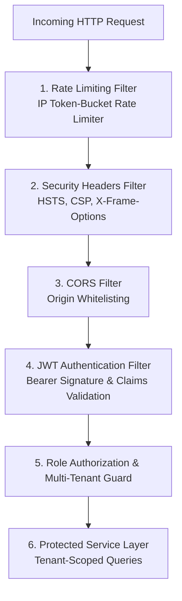

# Comprehensive Security & Multi-Tenancy Architecture Document

**Project**: Multi-Restaurant QR Code In-Dining & Reservation Platform  
**Target Audience**: Academic Mentors, Security Evaluators, Cloud Architects, and Technical Leads  
**Standards & References**: OWASP Top 10 (2021/2025), NIST SP 800-63B, Jakarta Security, RFC 7519 (JWT)  

---

## 1. Executive Summary & Security Posture

In a multi-tenant hospitality environment where multiple competing restaurants, kitchen staff, waiters, and anonymous dining guests interact concurrently on a single shared platform, security cannot be an afterthought. 

This platform implements a **Zero-Trust Multi-Tenant Architecture** backed by cryptographic token verification, adaptive password hashing, strict Role-Based Access Control (RBAC), and automated defenses against direct object references (IDOR), denial-of-service, and injection attacks.



---

## 2. Strict Multi-Tenant Data Isolation (Anti-IDOR)

### 2.1 The Vulnerability: Insecure Direct Object Reference (IDOR)
In naive implementations, staff or manager endpoints accept a `restaurantId` or query parameter from the client (e.g. `GET /api/kitchen/orders?restaurantId=2`). A rogue employee or malicious user could simply alter this number to inspect sales, read secret recipes, or cancel orders belonging to a competing restaurant.

### 2.2 Our Hardened Architecture: Principal-Derived Isolation
In this system, **client-supplied `restaurantId` parameters are strictly forbidden for staff actions**:
1. When a staff member logs in, their verified `restaurant_id` is embedded inside a cryptographically signed JWT.
2. For every incoming staff request, the `JwtAuthenticationFilter` extracts this claim and injects a `StaffPrincipal` into the thread-local `SecurityContext`.
3. The service layer retrieves the `restaurantId` directly from the authenticated principal:
   ```java
   StaffPrincipal principal = SecurityUtil.getAuthenticatedStaff();
   Long tenantRestaurantId = principal.getRestaurantId();
   return orderRepository.findByRestaurantIdAndStatus(tenantRestaurantId, OrderStatus.PLACED);
   ```
4. Even if an attacker passes `?restaurantId=999` in the URL or payload, it is completely ignored. Cross-tenant leakage is mathematically impossible without forging the cryptographic JWT secret key.

---

## 3. Authentication Architecture (JWT & Table Sessions)

The application maintains a secure separation between **Staff Accounts** and **Customer Diners**.

### 3.1 Staff Authentication (Signed JWTs)
- **Algorithm**: HMAC-SHA256 using standard JJWT library.
- **Key Storage**: High-entropy secret key (minimum 256 bits) configured via environment variable `JWT_SECRET` with zero hardcoding in source code.
- **Token Claims Payload**:
  ```json
  {
    "sub": "chef_mario",
    "role": "KITCHEN",
    "restaurantId": 1,
    "restaurantName": "Mario's Italian Bistro",
    "iat": 1729112400,
    "exp": 1729198800
  }
  ```
- **Lifecycle & Expiration**: 24-hour sliding window (`86,400,000 ms`), ideal for physical dining shift coverage.
- **Client Handling**: Stored in `localStorage`. Automatically cleared upon receiving `401 Unauthorized` responses.

### 3.2 Customer In-Dining Authentication (Cryptographic Table Sessions)
- Diners are anonymous guests; requiring registration would create fatal checkout friction.
- Instead, diners authenticate via a **Session Token** (`SESS-XXXXXX`) generated when scanning a table's physical QR code.
- A table's QR code contains an unguessable cryptographic token (`qrToken`). When scanned, the backend verifies that the table is active and issues a single active `TableSession`.
- Co-diners sitting at the same physical table share this session token, enabling synchronized ordering while preventing unauthorized table hijacking from outside the restaurant.

---

## 4. Role-Based Access Control (RBAC) Matrix

| Endpoint Group | `ADMIN` (Manager) | `KITCHEN` (Chef) | `WAITER` (Floor) | `CUSTOMER` (Diner) | Unauthorized Guest |
| :--- | :---: | :---: | :---: | :---: | :---: |
| `/api/auth/**` | :white_check_mark: Allowed | :white_check_mark: Allowed | :white_check_mark: Allowed | :white_check_mark: Allowed | :white_check_mark: Allowed |
| `/api/customer/**` | :white_check_mark: Allowed | :white_check_mark: Allowed | :white_check_mark: Allowed | :white_check_mark: Allowed | :white_check_mark: Allowed |
| `/api/kitchen/**` | :white_check_mark: Allowed | :white_check_mark: Allowed | :x: 403 Forbidden | :x: 401 Unauthorized | :x: 401 Unauthorized |
| `/api/waiter/**` | :white_check_mark: Allowed | :x: 403 Forbidden | :white_check_mark: Allowed | :x: 401 Unauthorized | :x: 401 Unauthorized |
| `/api/manager/**` | :white_check_mark: Allowed | :x: 403 Forbidden | :x: 403 Forbidden | :x: 401 Unauthorized | :x: 401 Unauthorized |

- **401 Unauthorized**: Returned immediately when the `Authorization: Bearer <token>` header is missing, malformed, expired, or tampered with.
- **403 Forbidden**: Returned when an authenticated staff member attempts an action outside their role privileges (e.g., a waiter attempting to access financial analytics in `/api/manager/analytics/dashboard`).

---

## 5. Cryptographic Password Hashing

### 5.1 The Standard: BCrypt (Strength 12)
Passwords in the database are hashed using the **BCrypt adaptive slow-hashing algorithm**:
- **Work Factor (Cost)**: `12` ($\approx 4,096$ key expansion iterations), calibrated to resist GPU-based dictionary and rainbow table cracking.
- **Per-Password Salt**: A unique 128-bit cryptographically secure random salt is generated and stored directly within each BCrypt hash output.
- **Zero Plaintext Fallback**: Legacy plaintext equality checks (`password.equals(dbPassword)`) have been permanently expunged from the codebase.

---

## 6. Defense-in-Depth Middleware Filters

### 6.1 `RateLimitingFilter.java`
- Protects public authentication endpoints (`/api/auth/login`) and customer order endpoints against automated brute-force and Denial-of-Service (DoS) floods.
- Implements an IP-based sliding token bucket algorithm (allowing up to 60 requests per minute per IP address with burst capacity).
- Excessive requests are throttled with `HTTP 429 Too Many Requests`.

### 6.2 `SecurityHeadersFilter.java`
Every HTTP response emitted by the Spring Boot server includes hardened browser security headers:
```http
X-Content-Type-Options: nosniff
X-Frame-Options: DENY
X-XSS-Protection: 1; mode=block
Content-Security-Policy: default-src 'self'; script-src 'self' 'unsafe-inline';
Strict-Transport-Security: max-age=31536000; includeSubDomains
Referrer-Policy: strict-origin-when-cross-origin
```
- **Clickjacking Protection**: `X-Frame-Options: DENY` ensures malicious third-party sites cannot embed the restaurant interface within an iframe to hijack diner payments.
- **MIME Sniffing**: `nosniff` prevents browsers from executing uploaded files as HTML or JavaScript.

### 6.3 CORS Origin Policy (`CorsConfig.java`)
- Strictly whitelists allowed production origins (`https://*.vercel.app`, `https://*.netlify.app`, and local development ports `http://localhost:[*]`).
- Disallows wildcard credentials sharing and restricts allowed HTTP verbs to `GET, POST, PUT, PATCH, DELETE, OPTIONS`.

---

## 7. OWASP Top 10 Compliance Matrix

| OWASP Vulnerability | Risk Scenario in Restaurant Platform | Mitigation Strategy in Codebase |
| :--- | :--- | :--- |
| **A01: Broken Access Control** | Waiter viewing manager revenue or modifying other restaurants' tables. | Role-Based Access Control + JWT principal tenant isolation on all queries. |
| **A02: Cryptographic Failures** | Plaintext database leak revealing staff passwords. | Standard BCrypt hashing with work factor 12 and salted hashes. |
| **A03: Injection** | SQL injection via menu search or table number inputs. | Spring Data JPA parameterized queries and ORM object mapping (zero concatenated SQL). |
| **A04: Insecure Design** | Co-diners colliding or double billing table orders. | 5-second duplicate order debounce and transactional table checkout. |
| **A05: Security Misconfiguration** | Unprotected actuator metrics exposing system environment. | Actuator restricted to health check probes; stack traces suppressed in production. |
| **A07: Identification & Auth Failures** | Brute force password guessing on staff accounts. | IP token-bucket rate limiting filter throttling failed attempts. |
| **A08: Software & Data Integrity** | Modifying dish prices on the client before checkout. | Prices strictly computed from database entities; client prices ignored. |

---

## 8. Mentor Presentation Slide Highlights (PPT Cheat Sheet)

- **Slide 1: Zero-Trust Multi-Tenancy**
  - "Tenants are isolated at the database query level using JWT claims. Insecure Direct Object References (IDOR) are architecturally prevented."
- **Slide 2: Enterprise Password Security**
  - "Passes NIST SP 800-63B guidelines using BCrypt cost factor 12 with automatic salting and zero plaintext fallbacks."
- **Slide 3: Comprehensive Layered Defense**
  - "Protected by a 4-tier filter chain: IP Rate Limiting $\rightarrow$ Security Headers $\rightarrow$ CORS Whitelist $\rightarrow$ JWT Signature Verification."
- **Slide 4: Zero Client Trust on Financials**
  - "All dish prices, 5% tax computations, and subtotal calculations occur on the server side, eliminating client-side price tampering."
