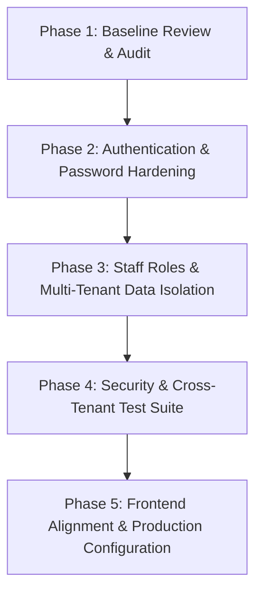

# Security Hardening & Architecture Plan

This document establishes the official, phased security hardening roadmap for the **In-Dining QR Code Ordering & Reservation Platform**. 

The main backend in [`backend/`](file:///d:/DevSpace/Restaurant-QR-Ordering-System/backend) serves as the canonical source of truth and target of this plan. The alternative [`simple-backend/`](file:///d:/DevSpace/Restaurant-QR-Ordering-System/simple-backend) is retained temporarily as an educational reference and will not be modified or removed during this process.

---

## Roadmap Overview

---

## Phase 1: Baseline Review of Existing Authentication & Password Handling

### 1.1 Purpose
Perform an exhaustive code and data-flow audit of the baseline backend to document exact attack surfaces, identify dead security code, verify test suite stability, and map authentication state across client and server.

### 1.2 Affected Areas
- **Backend Security Components**:
  - [`backend/.../security/TokenProvider.java`](file:///d:/DevSpace/Restaurant-QR-Ordering-System/backend/src/main/java/com/qr_restaurant/qr_restaurant_backend/security/TokenProvider.java) (HMAC token generation, unused token verification)
  - [`backend/.../security/PasswordEncoderUtil.java`](file:///d:/DevSpace/Restaurant-QR-Ordering-System/backend/src/main/java/com/qr_restaurant/qr_restaurant_backend/security/PasswordEncoderUtil.java) (Static salt SHA-256 implementation)
  - [`backend/.../service/AuthService.java`](file:///d:/DevSpace/Restaurant-QR-Ordering-System/backend/src/main/java/com/qr_restaurant/qr_restaurant_backend/service/AuthService.java) (Login password matching logic with plaintext fallback)
  - [`backend/.../config/DataInitializer.java`](file:///d:/DevSpace/Restaurant-QR-Ordering-System/backend/src/main/java/com/qr_restaurant/qr_restaurant_backend/config/DataInitializer.java) (Default seeded credentials and raw DDL index execution)
- **Frontend Interceptors & State**:
  - [`frontend/src/services/api.js`](file:///d:/DevSpace/Restaurant-QR-Ordering-System/frontend/src/services/api.js) (Axios request interceptor attaching `Bearer` token; 401 handling)
  - [`frontend/src/App.jsx`](file:///d:/DevSpace/Restaurant-QR-Ordering-System/frontend/src/App.jsx) (`handleLogout` clearing `staffUser` while retaining `authToken`)
- **Existing Test Suite**:
  - Baseline verification: 6 unit/integration tests running in H2 test database.

### 1.3 Acceptance Checks
- [ ] Confirmed baseline test suite compiles and passes 100% via `./mvnw test` (6 tests passing).
- [ ] Cataloged all endpoints that currently accept requests without credential validation.
- [ ] Documented all locations where plaintext password matching is permitted.
- [ ] Documented storage locations and lifecycles of auth tokens in the React client.

### 1.4 Dependencies
- None (Phase 1 is the prerequisite baseline for all subsequent phases).

### 1.5 Unresolved Design Decisions
1. **Spring Security Integration Style**: Should the team introduce standard `spring-boot-starter-security` with a `SecurityFilterChain` bean, or build a lightweight, educational `OncePerRequestFilter` to keep the code easier for a novice developer to digest?
2. **Backward Compatibility for Seeded / Existing Passwords**: Should legacy accounts with existing SHA-256 hashes be automatically re-hashed to BCrypt on next successful login, or should the database seed data be reset with new BCrypt hashes directly?

---

## Phase 2: Genuine Request Authentication & Secure Password Storage

### 2.1 Purpose
Transition from custom, unverified token strings and static salted SHA-256 to industry-standard BCrypt password hashing and cryptographic JWT authentication verified on every protected request.

### 2.2 Affected Areas
- **Dependencies**:
  - [`backend/pom.xml`](file:///d:/DevSpace/Restaurant-QR-Ordering-System/backend/pom.xml): Evaluate addition of `spring-boot-starter-security` and standard JWT library (e.g. `jjwt-api`, `jjwt-impl`, `jjwt-jackson`).
- **Security Utilities**:
  - [`PasswordEncoderUtil.java`](file:///d:/DevSpace/Restaurant-QR-Ordering-System/backend/src/main/java/com/qr_restaurant/qr_restaurant_backend/security/PasswordEncoderUtil.java): Replace custom SHA-256 with `BCryptPasswordEncoder` (strength 10-12). Remove plaintext fallback comparisons.
  - [`TokenProvider.java`](file:///d:/DevSpace/Restaurant-QR-Ordering-System/backend/src/main/java/com/qr_restaurant/qr_restaurant_backend/security/TokenProvider.java): Generate signed JWTs with standard claims (`sub` = userId/username, `role` = userRole, `restaurantId` = restaurantId). Load secret key from environment configuration.
- **Authentication Filter & Config**:
  - New `JwtAuthenticationFilter` extending `OncePerRequestFilter`: Intercept incoming HTTP requests, extract `Authorization: Bearer <token>`, validate signature and expiry, and populate authentication context.
  - Authentication Entry Point: Return consistent JSON `401 Unauthorized` responses instead of standard HTML error pages.
- **Service Layer**:
  - [`AuthService.java`](file:///d:/DevSpace/Restaurant-QR-Ordering-System/backend/src/main/java/com/qr_restaurant/qr_restaurant_backend/service/AuthService.java): Update `login()` and `registerRestaurant()` to use BCrypt verification and inject restaurant claims into the token.
  - [`DataInitializer.java`](file:///d:/DevSpace/Restaurant-QR-Ordering-System/backend/src/main/java/com/qr_restaurant/qr_restaurant_backend/config/DataInitializer.java): Seed default accounts (`admin`, `chef`, `waiter`) using BCrypt hashes.

### 2.3 Acceptance Checks
- [ ] Attempting to access staff endpoints (`/api/kitchen/**`, `/api/waiter/**`, `/api/manager/**`) without a valid `Bearer` token yields `HTTP 401 Unauthorized`.
- [ ] Tampered or expired JWT tokens are rejected immediately with `HTTP 401 Unauthorized`.
- [ ] Login verifies passwords strictly through BCrypt; entering plaintext matching passwords for un-hashed users fails.
- [ ] Existing 6 baseline tests continue to compile and pass.

### 2.4 Dependencies
- Requires completion of Phase 1 audit.

### 2.5 Unresolved Design Decisions
1. **JWT Expiration & Refresh Strategy**: Should access tokens have a short lifespan (e.g., 1–2 hours) with refresh tokens, or a 24-hour sliding window suitable for physical dining shifts?
2. **Customer Table Session vs. Staff Token Boundary**: Do customers accessing `/api/customer/**` require full JWT tokens, or does the lightweight `TableSession` token (`SESS-XXXXXX`) remain the appropriate session tracking mechanism for table guests?

---

## Phase 3: Staff Role Enforcement & Multi-Tenant Data Isolation

### 3.1 Purpose
Enforce Role-Based Access Control (RBAC) so that staff members can only perform operations permitted by their specific role (`ADMIN`, `KITCHEN`, `WAITER`), and guarantee strict multi-tenant data isolation so that staff from Restaurant A can never view or manipulate data belonging to Restaurant B.

### 3.2 Affected Areas
- **Controllers**:
  - [`ManagerController.java`](file:///d:/DevSpace/Restaurant-QR-Ordering-System/backend/src/main/java/com/qr_restaurant/qr_restaurant_backend/controller/ManagerController.java): Restrict all routes to role `ADMIN`.
  - [`KitchenController.java`](file:///d:/DevSpace/Restaurant-QR-Ordering-System/backend/src/main/java/com/qr_restaurant/qr_restaurant_backend/controller/KitchenController.java): Restrict routes to roles `KITCHEN` and `ADMIN`.
  - [`WaiterController.java`](file:///d:/DevSpace/Restaurant-QR-Ordering-System/backend/src/main/java/com/qr_restaurant/qr_restaurant_backend/controller/WaiterController.java): Restrict routes to roles `WAITER` and `ADMIN`.
  - [`CustomerController.java`](file:///d:/DevSpace/Restaurant-QR-Ordering-System/backend/src/main/java/com/qr_restaurant/qr_restaurant_backend/controller/CustomerController.java): Keep public routes accessible to diners with valid table context.
- **Service Layer Tenant Resolution**:
  - [`ManagerService.java`](file:///d:/DevSpace/Restaurant-QR-Ordering-System/backend/src/main/java/com/qr_restaurant/qr_restaurant_backend/service/ManagerService.java)
  - [`KitchenService.java`](file:///d:/DevSpace/Restaurant-QR-Ordering-System/backend/src/main/java/com/qr_restaurant/qr_restaurant_backend/service/KitchenService.java)
  - [`WaiterService.java`](file:///d:/DevSpace/Restaurant-QR-Ordering-System/backend/src/main/java/com/qr_restaurant/qr_restaurant_backend/service/WaiterService.java)
  - **Remove client-supplied `restaurantId` query parameters as proof of identity.** Extract the authenticated user's `restaurantId` from the security principal.
  - **Remove hardcoded `"gourmet-bistro"` fallback** and global cross-tenant data fallback.
- **IDOR Protection on Resource Mutations**:
  - `updateCategory`, `deleteCategory`: Verify target category belongs to caller's `restaurantId`.
  - `updateDish`, `toggleDishAvailability`, `deleteDish`: Verify target dish belongs to caller's `restaurantId`.
  - `updateTable`, `regenerateQrToken`, `deleteTable`, `checkoutAndLiberateTable`: Verify target table belongs to caller's `restaurantId`.
  - `updateOrderStatus`, `markOrderServed`: Verify target order belongs to caller's `restaurantId`.
  - `resolveAssistanceRequest`: Verify assistance request belongs to caller's `restaurantId`.

### 3.3 Acceptance Checks
- [ ] A user authenticated as `WAITER` or `KITCHEN` attempting to call `/api/manager/**` receives `HTTP 403 Forbidden`.
- [ ] A user authenticated as `WAITER` attempting to call `/api/kitchen/orders/{id}/status` receives `HTTP 403 Forbidden`.
- [ ] A Manager from Restaurant 1 attempting to update or delete a dish/table belonging to Restaurant 2 receives `HTTP 403 Forbidden` or `HTTP 404 Not Found`.
- [ ] Kitchen orders and Waiter table lists display strictly data belonging to the authenticated user's restaurant, with no global data leaks when query parameters are omitted.

### 3.4 Dependencies
- Requires Phase 2 (genuine token parsing and populated security context).

### 3.5 Unresolved Design Decisions
1. **Handling IDOR Mismatches**: When an authenticated user specifies a resource ID belonging to a different restaurant, should the API return `403 Forbidden` (explicit authorization failure) or `404 Not Found` (defensive non-disclosure to prevent ID enumeration)?
2. **Global Platform Admin Role**: Does the system need a `SUPER_ADMIN` role that can view and manage all restaurants simultaneously, or is `ADMIN` strictly scoped to a single restaurant?

---

## Phase 4: Automated Security & Multi-Tenancy Test Suite

### 4.1 Purpose
Introduce comprehensive, automated integration tests verifying unauthorized access rejection, role restrictions, and cross-tenant data isolation to prevent security regressions.

### 4.2 Affected Areas
- **Test Directory**:
  - [`backend/src/test/java/com/qr_restaurant/qr_restaurant_backend/`](file:///d:/DevSpace/Restaurant-QR-Ordering-System/backend/src/test/java/com/qr_restaurant/qr_restaurant_backend)
- **New Test Suites**:
  - `SecurityAuthenticationTest.java`: Verify missing tokens, malformed tokens, and expired tokens return `401 Unauthorized` across all protected routes.
  - `RoleAuthorizationTest.java`: Verify matrix of user roles (`ADMIN`, `KITCHEN`, `WAITER`, unauthenticated) against all controller endpoints.
  - `MultiTenantIsolationTest.java`: Seed two distinct restaurants (Restaurant A and Restaurant B); verify staff from Restaurant A cannot read or mutate Restaurant B's categories, dishes, tables, orders, or analytics.
  - `CustomerOrderIsolationTest.java`: Verify customer orders cannot order dishes from foreign restaurants or manipulate foreign table sessions.

### 4.3 Acceptance Checks
- [ ] Automated tests explicitly verify `401 Unauthorized` for unauthenticated requests.
- [ ] Automated tests explicitly verify `403 Forbidden` for role violations.
- [ ] Automated tests explicitly verify cross-tenant access rejection.
- [ ] Full Maven test suite passes completely with zero failures and zero errors via `./mvnw test`.

### 4.4 Dependencies
- Requires Phase 2 and Phase 3 implementation.

### 4.5 Unresolved Design Decisions
1. **Test Database Engine**: Should security tests run against the fast in-memory H2 database using MySQL compatibility mode, or should a Testcontainers MySQL container be introduced for 100% production dialect parity?

---

## Phase 5: Frontend Compatibility & Production Hardening

### 5.1 Purpose
Verify that the React frontend operates seamlessly with the hardened authentication and tenant boundaries, resolve client-side logout bugs, and eliminate dangerous production configuration settings.

### 5.2 Affected Areas
- **Frontend State & Storage**:
  - [`frontend/src/App.jsx`](file:///d:/DevSpace/Restaurant-QR-Ordering-System/frontend/src/App.jsx): Fix `handleLogout()` to purge both `staffUser` and `authToken` from `localStorage`.
  - [`frontend/src/services/api.js`](file:///d:/DevSpace/Restaurant-QR-Ordering-System/frontend/src/services/api.js): Confirm 401 interception redirects to login modal and purges tokens cleanly.
- **CORS Configuration**:
  - [`backend/src/main/java/com/qr_restaurant/qr_restaurant_backend/config/CorsConfig.java`](file:///d:/DevSpace/Restaurant-QR-Ordering-System/backend/src/main/java/com/qr_restaurant/qr_restaurant_backend/config/CorsConfig.java): Remove wildcard `*` with `allowCredentials(true)`. Restrict allowed origins strictly to configurable environment variables (`CORS_ALLOWED_ORIGINS`).
- **Database Initialization & Properties**:
  - [`backend/src/main/java/com/qr_restaurant/qr_restaurant_backend/config/DataInitializer.java`](file:///d:/DevSpace/Restaurant-QR-Ordering-System/backend/src/main/java/com/qr_restaurant/qr_restaurant_backend/config/DataInitializer.java): Remove risky raw `ALTER TABLE ... DROP INDEX` DDL statements from runtime startup code.
  - [`backend/src/main/resources/application.properties`](file:///d:/DevSpace/Restaurant-QR-Ordering-System/backend/src/main/resources/application.properties): Remove hardcoded fallback passwords; enforce environment variable injection for production credentials.

### 5.3 Acceptance Checks
- [ ] Logging out from the frontend completely clears all authentication tokens from the browser.
- [ ] Manager, Waiter, and Kitchen portals successfully fetch and display data using authenticated JWTs without passing manual `restaurantId` query parameters.
- [ ] CORS rejects unauthorized origins in production mode.
- [ ] Application starts cleanly without executing raw DDL statements or throwing dialect warnings.

### 5.4 Dependencies
- Requires Phase 2, Phase 3, and Phase 4 completion.

### 5.5 Unresolved Design Decisions
1. **Production Deployment Platform**: Which host will run the Spring Boot API (Render, Railway, or AWS)? This dictates how environment variables and CORS headers are injected.
2. **Table Reservation Scheduling Scope**: The README and product vision note table pre-booking, but the current backend is walk-in only. Will date/time reservation scheduling be added in a future milestone after security hardening?

---

## Summary of Phases

| Phase | Title | Primary Focus | Key Deliverable |
| :---: | :--- | :--- | :--- |
| **Phase 1** | Baseline Review | Audit existing code & tests | Comprehensive attack surface & baseline verification |
| **Phase 2** | Auth & Password Hardening | BCrypt & genuine JWT | Protected endpoints rejecting unauthenticated traffic (401) |
| **Phase 3** | Roles & Tenant Isolation | RBAC & server-derived tenancy | Complete isolation between restaurants & roles (403) |
| **Phase 4** | Automated Security Tests | Integration test coverage | Automated test suite verifying 401, 403, and IDOR prevention |
| **Phase 5** | Frontend & Production | Client parity & config hardening | Secure logout, strict CORS, and production readiness |
