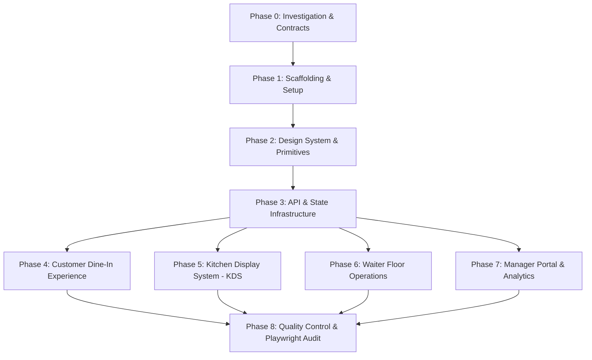

# Frontend Implementation Plan: Restaurant QR Ordering Platform (`frontend-v2`)

**Status:** Phase 0 Investigation Complete — Awaiting User Approval to Begin Scaffolding  
**Architecture:** React 19 + Vite 6 + Tailwind CSS + Global Design System  
**Themes:** Verdant Signal Light & Obsidian & Forest Dark  
**Brand Logo:** Circular `Bhargav_KB_Logo.png`  
**Backend:** Spring Boot 4.1.0 (`http://localhost:8080`)  

---

## Roadmap Overview

---

## Detailed Implementation Phases

### Phase 0: Architecture Investigation & Contract Definition (COMPLETED)
- [x] Full audit of Spring Boot 4.1.0 backend controllers, services, repositories, models, and DTOs.
- [x] Full audit of backup frontend application and pain points.
- [x] Verification of Global Design System tokens (`Verdant Signal` & `Obsidian & Forest`).
- [x] Inspection of circular brand logo asset (`Bhargav_KB_Logo.png`).
- [x] Documentation written: `docs/architecture/PROJECT_AUDIT.md`, `docs/architecture/API_CONTRACT.md`.

---

### Phase 1: Frontend Workspace Scaffolding (`frontend-v2/`)
- [ ] Initialize clean Vite + React 19 project inside `frontend-v2/`.
- [ ] Configure `vite.config.js` with API proxy forwarding `/api` to `http://localhost:8080`.
- [ ] Configure Tailwind CSS with design system semantic color variables.
- [ ] Import and format `Bhargav_KB_Logo.png` into `public/assets/` as a clean circular brand element.
- [ ] Establish directory structure (`components/`, `pages/`, `hooks/`, `services/`, `context/`, `styles/`, `types/`).

---

### Phase 2: Design System Integration & UI Primitive Components
- [ ] Import design tokens from `D:\DesignSystems\Global-Design-System` (`tokens.css`, `themes.css`).
- [ ] Implement theme manager hook (`useTheme`) supporting:
  - **Verdant Signal Light:** Botanical green accents, warm parchment backgrounds, clean crisp surfaces.
  - **Obsidian & Forest Dark:** Deep obsidian (`#0B0F0E`), emerald/forest accents (`#10B981`), silver-white text, subtle gold highlights.
- [ ] Build reusable UI primitives:
  - `Button` (primary, secondary, danger, outline, ghost, sizes with loading spinners)
  - `Card` (elevated surface with subtle border and backdrop blur)
  - `Badge` (status badges for `AVAILABLE`, `OCCUPIED`, `PLACED`, `PREPARING`, `READY`, `SERVED`)
  - `Modal` / `Drawer` (accessible dialog with keyboard traps and backdrop overlay)
  - `Input` & `Select` (accessible form elements with floating labels and error states)
  - `CircularLogo` (responsive brand component displaying `Bhargav_KB_Logo.png`)
  - `ThemeToggle` (one-click theme switcher)

---

### Phase 3: Core API Services & State Management Layer
- [ ] Axios client with request/response interceptors:
  - Automatically attaches `Authorization: Bearer <token>` for staff routes.
  - Handles 401 unauthorized redirects to `/login`.
  - Structured error message extraction for toast notifications.
- [ ] **TableSessionStore / Context:**
  - Manages `sessionToken`, `tableNumber`, `restaurantSlug`, `restaurantId`, `tableStatus`.
  - Syncs state with `localStorage` to survive mobile browser reloads.
- [ ] **CartStore / Context:**
  - Items, quantities, item notes (`specialRequest`), subtotal calculation.
  - Add to cart, increment/decrement, remove, and clear operations.
- [ ] **AuthStore / Context:**
  - Staff token, username, role (`ROLE_ADMIN`, `ROLE_KITCHEN`, `ROLE_WAITER`), restaurant info.

---

### Phase 4: Customer Dine-In Experience (Mobile-First)
- [x] **QR Landing & Session Start:**
  - URL parameter detection (`/table/:tableNumber`, `/r/:restaurantSlug/table/:tableNumber`, `/qr/:qrToken`).
  - Auto-initializes or resumes session via `POST /api/customer/session/start`.
- [x] **Menu Browsing & Search:**
  - Category pill filter carousel with smooth scrolling.
  - Live dish search input with instant filtering.
  - Dietary chips (Vegetarian, Non-Veg, Chef's Special).
  - Dish card with dish image, pricing, preparation time, and "Add" button with quantity stepper.
- [x] **Dish Detail Modal:**
  - High-res visual presentation, full description, allergy warnings, special cooking notes input.
- [x] **Cart & Order Drawer:**
  - Sticky bottom order bar with item count and subtotal preview.
  - Slide-up cart drawer with order review, table-level special instructions, and "Send to Kitchen" CTA.
- [x] **Live Order Tracker:**
  - Real-time order progress timeline (`PLACED` ➔ `PREPARING` ➔ `READY` ➔ `SERVED`).
  - Itemized dish status breakdown.
  - Order cancellation button (active only while status is `PLACED`).
  - Smart polling (every 12s) with manual refresh button.
- [x] **Call Waiter Feature:**
  - Quick-action floating button opening assistance options: Water, Bill, Waiter Help, Clean Table.
  - Instant confirmation toast and request status.
- [x] **Bill & Digital Checkout:**
  - Itemized receipt modal (Subtotal, 5% Tax, Tip selector, Grand Total).
  - Payment method selector (`CASH`, `CARD`, `UPI_QR`).
  - Simulated payment processing with animated receipt summary.

---

### Phase 5: Kitchen Display System (KDS)
- [x] Dedicated full-screen route (`/kitchen`, `/kds`, `/staff/login`).
- [x] Role-protected operations interface (`ROLE_KITCHEN` or `ROLE_ADMIN`).
- [x] Active ticket grid displaying `PLACED` (Incoming Orders) and `PREPARING` (In Preparation) orders.
- [x] Elapsed preparation timers with visual urgency thresholds (normal, warning at 10m, urgent at 20m).
- [x] Action workflow buttons: "Start Preparation" (`PATCH /api/kitchen/orders/{id}/status?status=PREPARING`) and "Mark Ready for Service" (`PATCH /api/kitchen/orders/{id}/status?status=READY`).
- [x] Synthesized Web Audio API bell chime and subtle badge alert on new order ticket arrivals with staff mute toggle.
- [x] 8-second background polling with tab visibility pausing and live connection status indicators (`LIVE SYNC`, `RECONNECTING`, `OFFLINE`).
- [x] End-to-end verified with live customer orders placed from Table 2 and real Spring Boot MySQL updates.

---

### Phase 6: Waiter Floor Portal (COMPLETED)
- [x] Dedicated route (`/waiter`, `/floor`, `/staff/waiter`).
- [x] **Floor Overview:** Grid of restaurant tables with real-time status indicators (`AVAILABLE`, `OCCUPIED`, `BILL_REQUESTED`, `CLEANING_NEEDED`).
- [x] **Pending Assistance Queue:** Alert queue displaying customer help calls (`WATER`, `BILL_REQUEST`, `WAITER_HELP`, `CLEAN_TABLE`) with 1-click "Resolve" button.
- [x] **Ready-to-Serve Queue:** Alerts for dishes marked ready by kitchen with 1-click "Mark Served" action.
- [x] **Table Checkout Action:** Final checkout and table liberation workflow with itemized bill preview and confirmation modal.
- [x] Role-protected station requiring `ROLE_WAITER` or `ROLE_ADMIN` (blocks unauthorized `ROLE_KITCHEN` and guest users).
- [x] 10-second smart polling with visibility change pause/resume and connection status indicators (`FLOOR SYNC`, `RECONNECTING`, `OFFLINE`).
- [x] Web Audio API bell chime for incoming ready food and assistance calls with mute toggle.
- [x] Verified end-to-end with live Spring Boot backend, Playwright automated testing, and responsive audit across Desktop, Tablet, and Mobile.

---

### Phase 7: Manager & Administration Portal
- [ ] Dedicated route (`/manager`).
- [ ] **Analytics Dashboard:** Revenue KPI cards, total orders, average ticket size, active occupancy, top-selling dishes chart.
- [ ] **Category Management:** Modal to add, edit, reorder, or delete menu categories.
- [ ] **Dish Catalog Management:** Add/edit dishes, toggle availability (86ing items), edit prices, assign categories.
- [ ] **Table & QR Management:** Add new tables, configure capacity, regenerate QR tokens, and generate printable QR code badges.
- [ ] **Order History:** Paginated table of all restaurant orders with status filters.

---

### Phase 8: Quality Assurance, Playwright & Visual Polish
- [ ] Comprehensive responsive audit across Desktop (1920x1080), Tablet (768x1024), and Mobile (375x812).
- [ ] Zero horizontal or unintended vertical overflow checks.
- [ ] WCAG 2.1 AA accessibility audit (contrast, aria-labels, keyboard navigation).
- [ ] End-to-end user flow verification using Playwright:
  1. Scan QR ➔ Browse ➔ Add to Cart ➔ Place Order.
  2. Kitchen transitions order to Preparing ➔ Ready.
  3. Waiter serves order.
  4. Customer pays bill ➔ Session closes.
- [ ] Production build (`npm run build`) verification with zero bundle errors.
